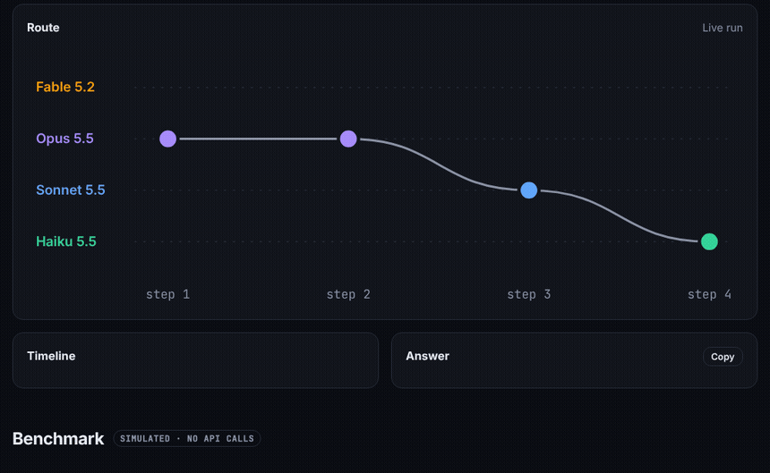
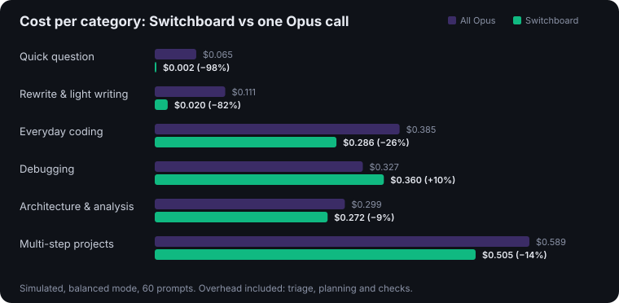
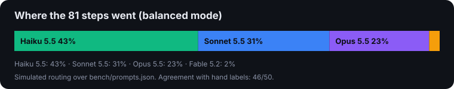
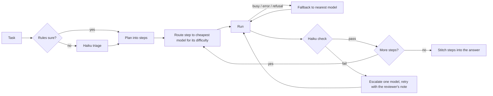

<div align="center">

# Switchboard

**The right Claude model for every step.**

Switchboard plans a task, sends each step to the cheapest Claude model that can do it well, checks the work, and switches models mid-task: up when a check fails, back down when the work gets easy.

[](https://switchboard.mridulmerges.ca)
[](test/engine.test.ts)
[](tsconfig.json)
[](#models-and-prices)
[](LICENSE)



<sub>Demo run with simulated model replies. Step 2's check fails, so it moves from Sonnet up to Opus. The README step drops down to Haiku.</sub>

</div>

## Results

Benchmark: **60 realistic prompts** in 6 categories, from one-line questions to four-part build tasks ([`bench/prompts.json`](bench/prompts.json)). Every prompt is routed by Switchboard and priced against **one Claude Opus 5.5 call writing the same amount of output**.

> **Simulated, not measured.** No API calls are made. Routing is Switchboard's real (free) rules engine, but token counts come from a cost model ([`bench/run.ts`](bench/run.ts)), not from real responses. Switchboard's side includes its overhead: Haiku triage, the planner and a Haiku check after every step. Thinking tokens aren't counted on either side. Reproduce it with `npm run bench`.

| Mode | Cost (60 prompts) | vs all-Opus ($1.78) | Cheaper on | Steps on Haiku · Sonnet · Opus · Fable |
|---|---|---|---|---|
| Save money | $1.12 | **−37%** | 54 / 60 | 51% · 40% · 7% · 2% |
| **Balanced** (default) | **$1.44** | **−19%** | **46 / 60** | 43% · 31% · 23% · 2% |
| Best quality | $2.11 | +19% | 25 / 60 | 22% · 28% · 40% · 10% |





**What the numbers say:**

- **Savings come from easy prompts.** Quick questions cost 98% less and light writing 82% less, because Haiku is 1/40th of Opus's price per token.
- **On hard work, routing roughly breaks even.** Debugging cost 10% *more*: those prompts go to Opus anyway, plus the checks. Architecture saved 9% and multi-step projects saved 14%.
- **It uses more tokens, not fewer.** That's 2.6× the tokens of a single Opus call, because every step rereads the task and earlier steps, and every check reads the output again. They're just much cheaper tokens.
- **Failed checks eat the savings.** If about 1 in 7 checked steps fails and escalates (8 escalations across the 60 prompts), balanced mode drops to −1%, which is break-even.
- **Routing agrees with hand labels on 46 of 50** single-model prompts (labels written by the author, so treat this as a sanity check).

## How it works



| Stage | What happens | Model |
|---|---|---|
| **Triage** | Free regex rules score difficulty from 1 to 5. If they aren't confident, Haiku rates it. | rules → Haiku 5.5 |
| **Plan** | Multi-step tasks are split into 2-5 steps, each with its own difficulty. | Sonnet 5.5 (Opus 5.5 for hard tasks) |
| **Route** | Each step goes to the cheapest model for its difficulty. The mode moves the cut-offs. | Haiku / Sonnet / Opus / Fable |
| **Check** | Haiku grades each step. A fail moves the step up one model and retries it with the reviewer's note. | Haiku 5.5 |
| **Learn** | If one kind of step needed escalating, later steps of that kind start higher. Two clean passes in a row reset this. | |
| **Fallback** | Overloaded (529), rate-limited (429) or erroring models fall through to the nearest model. Refusals use the API's server-side fallback. | |
| **Guardrails** | A budget cap per run and at most 2 escalations per step. | |
| **Compose** | Finished steps are stitched into one answer (free). Optionally, Sonnet rewrites them (`compose: "merge"`). | |

```text
for step in plan(task):
    model = cheapest_model_for(step.difficulty)
    loop:
        out = run(model, step)          # busy or refused → next model
        if check(out).passes: break
        if over_budget or at_top: break
        model = one_level_up(model)     # escalate and retry
    after 2 clean passes: drop back down
```

## Models and prices

USD per 1M tokens, Claude API list prices (November 2026).

| Model | ID | Input | Output | Effort used |
|---|---|---|---|---|
| Haiku 5.5 | `claude-haiku-5-5` | $0.10 | $0.50 | low |
| Sonnet 5.5 | `claude-sonnet-5-5` | $2 | $10 | medium |
| Opus 5.5 | `claude-opus-5-5` | $4 | $20 | high |
| Fable 5.2 | `claude-fable-5-2` | $8 | $40 | high |

## Try it

**Online:** [switchboard.mridulmerges.ca](https://switchboard.mridulmerges.ca). *Preview routing* is free and makes no API calls. *Run live* uses your own Anthropic API key, which stays in your browser and goes only to `api.anthropic.com`. There's no server, so nobody else's key is involved.

**Locally:**

```bash
npm install
npm run dev      # the site
npm test         # engine tests, offline, with a scripted fake model
npm run bench    # regenerate bench/results.json and the charts
npm run build    # static site in dist/
```

## Code map

| File | What it does |
|---|---|
| [`src/rules.ts`](src/rules.ts) | Free triage rules: difficulty, task kind, confidence |
| [`src/policy.ts`](src/policy.ts) | Difficulty → model for each mode |
| [`src/engine.ts`](src/engine.ts) | Planner, per-step routing, checks, escalation, de-escalation, fallback, budget |
| [`src/anthropic.ts`](src/anthropic.ts) | Claude API adapter: streaming, structured outputs, server-side fallback |
| [`src/llm.ts`](src/llm.ts) | Provider interface, so tests and benchmarks run offline |
| [`src/main.ts`](src/main.ts) | The site, the route diagram and the benchmark view |
| [`bench/`](bench) | Prompt set, cost model, results |

## Trade-offs

- Every check is an extra call, and splitting a task loses some of the context one big prompt would have.
- The rules are simple, so a cleverly worded easy prompt can be over-routed (and the reverse). The Haiku triage and the checker are the safety net.
- **When to skip it:** for one hard question, just ask Opus or Fable directly. Switchboard pays off when a task mixes hard and easy parts.

## Roadmap

- [ ] Benchmark with real API runs (real tokens and quality scores), not just the cost model
- [ ] Claude Code plugin, so model routing works inside coding sessions
- [ ] Prompt caching across steps to cut the repeated-context cost

---

Built in public by [Mridul Sharma](https://www.linkedin.com/in/mridulmerges) · Tech, explained simply.
